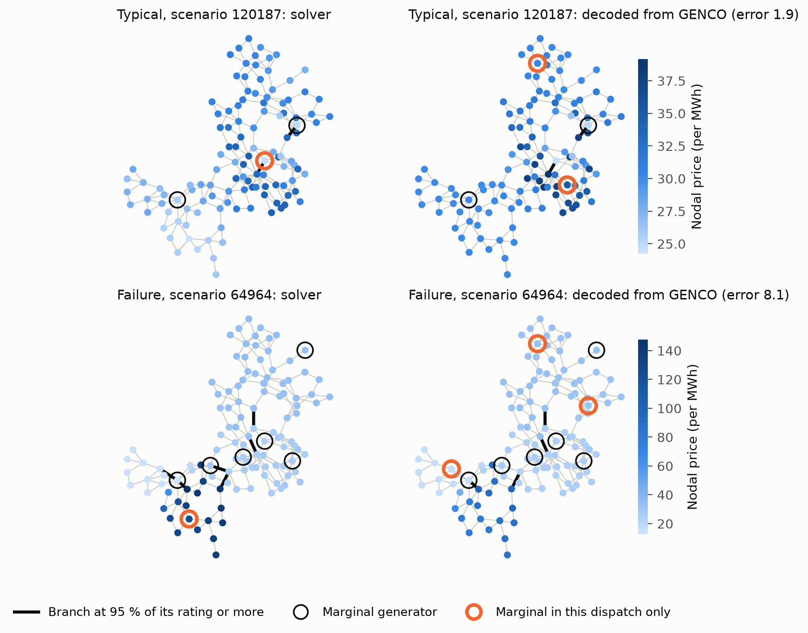
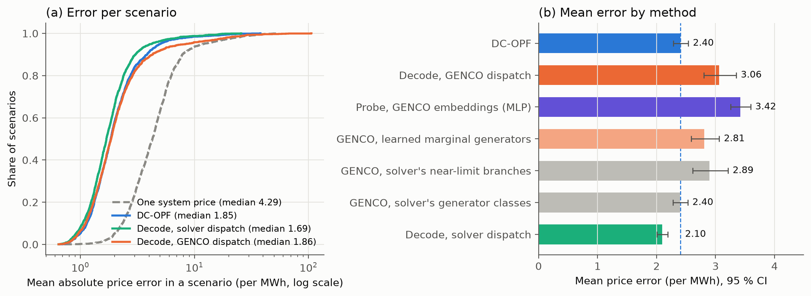
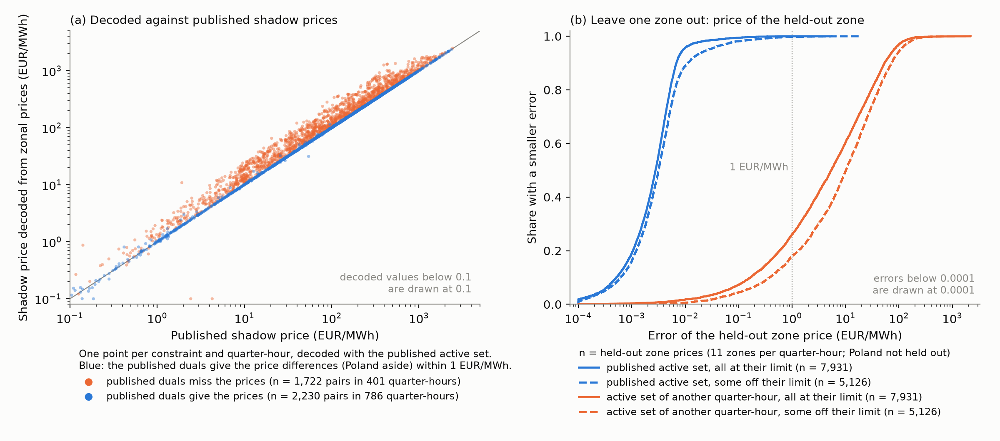

# Does GENCO know the prices?

Code and results of our entry in the [GridFM GENCO Challenge 2026](https://huggingface.co/spaces/gridfm/genco-challenge).

Can we extend GENCO to predict the dual variables of the AC optimal power flow (AC-OPF)? As an example, we test the
nodal prices (locational marginal prices, LMPs). This repository reads the generator classes (marginal, at the upper
limit, at the lower limit) and the branches near their limits from GENCO's predicted dispatch. One small linear
program per scenario then gives the nodal prices with the DC price formula. We compare the result with AC-OPF prices
on held-out IEEE 118 scenarios. Two more parts: probes that read the prices from GENCO's embeddings, and a test of the
same price formula on the real duals of the European Core day-ahead market (JAO data).

## Check the numbers in one minute

```bash
uv sync
uv run python -m genco_prices.evaluate summarize --tag test3000
uv run python -m genco_prices.probe summarize --tag test3000     # the embedding probes
```

This rebuilds the table below and the paired differences from `results/per_scenario_test3000.csv` alone (the error of
every method in every report scenario). `python -m genco_prices.figures` needs only the two saved CSV files for
Figure 2; Figure 1 needs the raw data and the GENCO predictions.

## Result

Report split: 1,632 held-out scenarios in 586 load groups. Error: mean absolute nodal price difference over the 118
buses of a scenario, in the cost unit of the data per MWh. 95 % intervals: bootstrap over load groups, 10,000 draws.

| Method | Mean [95 % CI] | Median | 95th percentile | Better than / equal to DC-OPF |
|---|---|---|---|---|
| One system price (no network) | 5.38 [5.14, 5.63] | 4.29 | 12.00 | 3 % / 0 % |
| DC-OPF | 2.40 [2.28, 2.54] | 1.85 | 4.99 | – |
| **Decode, GENCO dispatch** | **3.06 [2.80, 3.35]** | **1.86** | **8.42** | **46 % / 9 %** |
| Decode, GENCO dispatch, untuned (1 MW, 99 %) | 3.92 [3.71, 4.14] | 2.78 | 9.81 | 22 % / 3 % |
| Decode, GENCO dispatch, vertex rule | 2.95 [2.76, 3.16] | 2.07 | 6.80 | 36 % / 10 % |
| Decode, GENCO dispatch, learned marginal generators (exploratory) | 2.81 [2.59, 3.06] | 1.87 | 6.28 | 44 % / 11 % |
| Decode, GENCO dispatch, solver's near-limit branches (diagnostic) | 2.89 [2.61, 3.21] | 1.73 | 6.94 | 49 % / 11 % |
| Decode, GENCO dispatch, solver's generator classes (diagnostic) | 2.40 [2.28, 2.53] | 1.82 | 5.21 | 46 % / 15 % |
| Decode, solver dispatch (reference) | 2.10 [2.01, 2.19] | 1.69 | 4.19 | 50 % / 19 % |

Paired differences of the mean error (load-group bootstrap): decode on GENCO's dispatch minus DC-OPF +0.66
[0.42, 0.92]; learned marginal generators minus DC-OPF +0.40 [0.21, 0.63]; learned marginal generators minus the
margin rule −0.25 [−0.43, −0.08]; decode on the solver's dispatch minus DC-OPF −0.31 [−0.41, −0.21].

- **Equal.** Two scenario errors that differ by less than 0.001 per MWh count as equal.
- **Figure 1 examples.** Typical: the scenario with the median GENCO error (120187). Failure (64964): near the 95th
  percentile of GENCO's error, among scenarios where the solver's generator classes more than halve GENCO's error and
  GENCO's error is more than twice DC-OPF's. It illustrates the generator-class error; it is not a random tail case.
  Left panels: pandapower AC-OPF prices, with rings and thick branches from the stored solver dispatch.
- **Generator classes.** GENCO's dispatch has 6.0 marginal generators on average, the solver's dispatch 4.8 (7 MW
  rule). Near-limit branches: 3.6 against 4.1. The two diagnostic rows replace GENCO's generator classes (marginal,
  at the upper limit, at the lower limit) or GENCO's near-limit branches with the solver's. All costs in the data are
  linear, so this substitution changes the classes without changing the marginal costs. These rows explain the error
  inside this decoder; they are not available at inference.
- **Learned marginal generators** (`classify.py`, exploratory: we developed it after we saw the failure cases). A
  gradient-boosting classifier predicts whether a generator is marginal in the solver's dispatch, from GENCO's dispatch
  (slack to both limits, cost, cost rank, generator, counts of GENCO's active set). The fit uses these class labels;
  the decision threshold uses price labels (out-of-fold probabilities over 5 load-group folds, price error on the
  tuning scenarios). Both use the tuning scenarios only. A generator that is not marginal goes to its limit as in the
  margin rule, so this variant differs from the margin rule only in the marginal mask. No prices at inference.
- **Vertex rule.** Keep the k + 1 generators furthest from their limits, with k near-limit branches (a heuristic from
  the vertices of a linear DC-OPF). Its result is mixed: a better mean and 95th percentile than the margin rule, but a
  worse median, and a worse tuning error (3.02 against 2.68). The post leaves it out.
- **Scarcity scenarios.** Three report scenarios (120512, 128900, 153836) have an AC price of 500 per MWh or more at
  some bus. All methods have large errors there (DC-OPF: 14, 564 and 214 per MWh). The table excludes them. We
  chose this rule after we saw the data. With them (1,635 scenarios), the paired
  difference of GENCO's decode to DC-OPF is +0.59 [0.28, 0.88]. `results/counts_test3000.json` lists the details.
- **Tuning.** `results/labels/case118_test3000_tune_grid.csv` holds the full grid on 800 tuning scenarios.





## Second model: GENCO Base

The Base checkpoint (`case118_ieee/base/seed0`) saved the same split as Small (train, validation and test;
`check_split --model base` compares them), so the same labels apply.
Its tolerances are tuned separately on the same tuning scenarios (7 MW, 97 % loading). Same 1,632
report scenarios. Base has a lower dispatch error than Small (Pg RMSE 17.14 against 17.73 MW, published and
reproduced on the full test set), but no clear improvement in mean price error: the paired difference Base minus
Small is +0.14 [−0.20, +0.53] per MWh (learned variant: +0.10 [−0.15, +0.33]). Its 95th percentile is lower (6.92
against 8.42). GENCO Base's dispatch has 6.2 marginal generators on average.

| Method | Mean [95 % CI] | Median | 95th percentile | Better than / equal to DC-OPF |
|---|---|---|---|---|
| Decode, GENCO Base dispatch | 3.20 [2.90, 3.59] | 1.95 | 6.92 | 41 % / 8 % |
| ... learned marginal generators (exploratory) | 2.90 [2.71, 3.11] | 1.95 | 6.04 | 40 % / 9 % |
| ... solver's near-limit branches (diagnostic) | 2.73 [2.45, 3.09] | 1.71 | 5.84 | 50 % / 12 % |
| ... solver's generator classes (diagnostic) | 2.61 [2.47, 2.77] | 1.93 | 5.33 | 42 % / 11 % |

Run it with `GENCO_PRED=results/genco_opf_case118_base` and `--tag base` (see `reproduce.sh`).

## Duals from GENCO's embeddings (probe)

Exploratory (`probe.py`). Ridge and small MLP probes map one bus of one scenario to its AC-OPF price, from GENCO's
inputs, outputs or final bus embedding (192 values, `scripts/predict_embeddings.py`). Unlike DC-OPF and the decode,
every probe and every correction fits its weights to the AC prices of the 800 tuning scenarios. Same report split.

- No direct probe on GENCO's inputs, outputs or final bus embedding reaches DC-OPF (2.40) or the decode (3.06). The
  best, a small MLP on the embedding, gives 3.42 [3.25, 3.59] (3.38-3.52 over three seeds).
- A linear probe reads the price better from a bus's GENCO embedding than from that bus's GENCO outputs (3.62 against
  4.40, −0.78 [−0.84, −0.72]). With a small MLP and scenario context, the advantage goes away (+0.19 [0.08, 0.30]).
- A per-bus correction learned from AC prices lowers DC-OPF from 2.40 to 1.70. With the same correction, DC-OPF stays
  better than the decode by 0.91 [0.70, 1.14]. The correction does not remove GENCO's tail (95th percentile 8.38
  against 8.42; with learned marginal generators 6.38 against 6.28).
- Simple probes trained on 800 scenarios do not read the prices out well enough; this does not show that the
  information is absent from the embedding. Differences below about 0.15 per MWh (the MLP seed range) are indicative.

One-minute check: `uv run python -m genco_prices.probe summarize --tag test3000` rebuilds the probe tables from
`results/per_scenario_probe_test3000.csv` alone.

## Real data: the Core day-ahead market

`market.py` applies the price formula to the European Core flow-based market: 12 bidding zones, 02-15/10/2026,
1,344 quarter-hours (MTUs), JAO data. 95 % intervals: bootstrap over whole days, 2,000 draws.

- **Leave one zone out.** For each MTU and each zone except PL, we fit the other zone prices with the published
  active set and predict the held-out price: mean error 0.012 [0.007, 0.019] EUR/MWh, 99.9 % within 1 EUR/MWh
  (13,057 prices, 1,187 MTUs; PL is not held out, and its allocation limit is added as a row when it binds). With the active set of a random other MTU: 23 [17, 31] EUR/MWh, 23 % within 1.
- **Published shadow prices.** In 721 of the 1,187 MTUs with a published constraint (61 %), every published
  physical constraint is within 1 MW of its limit under the published net positions. There, the published shadow
  prices give the non-PL price differences within 1 EUR/MWh in 717 MTUs (99.4 %). In the other 466 MTUs (39 %; 72 %
  of them between 08:00 and 17:00), JAO's own ram_mcp also shows constraints off their limit, and the shadow prices
  give the prices in 15 % of MTUs only. The cause is not known (extended LTA inclusion is only a candidate). The
  held-out error stays small there (0.023 EUR/MWh).
- **No published constraint (157 MTUs).** 95 have one price everywhere. In the other 62, only PL has another price:
  PL is at its export allocation limit in all 62 (never at its import limit), and its price is lower.
- **Active set from the primal** (final domain of 14-15/10, 192 MTUs). In the 133 MTUs where no CNEC is above its
  RAM by more than 1 MW, the CNECs within 1 MW of their limit give the published set with recall 99.8 % and
  precision 93.9 % (exact set in 108). In the other 59 MTUs, recall is 34 %. We chose the 1 MW tolerance and the
  CNEC scope on these two days.
- **Decoded duals.** Where the published duals give the prices, decoding them from the prices is an identifiability
  check, not more evidence. On 14-15/10, one missed constraint moves the other duals by a median of 29 to 66 EUR/MWh;
  one extra constraint gets a dual of 0. The price-fit part of this test follows from LP monotonicity.



The per-quarter-hour result files (`results/market_core_*.csv` except the sweep) hold values derived from JAO data
and stay out of git; `market fetch` and `market analyse` rebuild them. `results/market_core_summary.json` holds every
number above.

## Setup

| Item | Value |
|---|---|
| Model | [`gridfm/genco-opf-datakit`](https://huggingface.co/gridfm/genco-opf-datakit) @ `2d24015`, `case118_ieee/small/seed0/last.pt` |
| Data | [`gridfm/opf_small_case118_ieee`](https://huggingface.co/datasets/gridfm/opf_small_case118_ieee) @ `5377c37` |
| Inference | `gridfm-graphkit` @ `8a8defb`; reproduces the published test metrics closely (Pg RMSE 17.727767 MW against 17.727774 MW published) |
| Test scenarios | 21,199; `check_split` shows that they are the checkpoint's saved test partition |
| Labels | pandapower 3.5.5 AC-OPF and DC-OPF on 3,000 random test scenarios (seed 0, `results/test_ids_3000.txt`); 2,942 solve |
| Label filter | keep a scenario if our AC-OPF cost is within 0.1 % of the stored one and every net bus injection within 10 MW: 2,435 scenarios |
| Tuning | 7 MW margin and 95 % loading, chosen on the 800 scenarios with `load_scenario_idx % 3 == 0`; report on the others |
| Uncertainty | 95 % intervals from a bootstrap over load groups (scenarios that share a load profile), 10,000 draws |

Two details of the label conversion matter (`genco_prices.labels.convert`). pandapower's `from_ppc` creates
transformers in service even when the case says out of service, and its OPF fixes the reference voltage magnitude. We
restore the branch statuses and make the reference voltage a variable, as in PowerModels.jl. The converter also drops
the ±30° branch angle limits; they are not active in our AC labels (largest angle difference 21.8°), and the thermal
limits keep every DC branch angle below 30°.

## Reproduce everything

Linux x86-64, Python 3.12, [uv](https://docs.astral.sh/uv/). About 9 GB of disk and 2-3 h on a laptop.

```bash
uv sync --group dev --group genco
uv run pytest -q                      # checks of the decoder and of the label conversion
./reproduce.sh                        # all steps below; WITH_BASE=1, WITH_PROBE=1, WITH_MARKET=1 add the options
```

| Step | Command | Output |
|---|---|---|
| Data and model | `hf download ...` (pinned revisions, see `reproduce.sh`) | `data/`, `checkpoints/` |
| GENCO predictions | `gridfm_graphkit evaluate ... --save_output` (see `reproduce.sh`) | `results/genco_opf_case118/` |
| Split check | `uv run python -m genco_prices.check_split` | console |
| AC-OPF and DC-OPF prices | `uv run python -m genco_prices.labels --scenarios results/test_ids_3000.txt --workers 1 --tag test3000` | `results/labels/case118_test3000_{summary,lmp,branch}.parquet` |
| Tune the tolerances | `uv run python -m genco_prices.evaluate tune --tag test3000` | `results/labels/case118_test3000_{tune_grid.csv,settings.json}` |
| Train the classifier | `uv run python -m genco_prices.classify --tag test3000` | `results/labels/case118_test3000_classifier.*` |
| Decode all variants | `uv run python -m genco_prices.evaluate decode --tag test3000` | `results/labels/case118_test3000_{decode,active_sets}.parquet` |
| Report | `uv run python -m genco_prices.evaluate report --tag test3000` | `results/*.csv`, `results/counts_test3000.json` |
| Figures | `uv run python -m genco_prices.figures --tag test3000` | `figures/` |
| Probes (optional, GPU) | `WITH_PROBE=1 ./reproduce.sh` (step 8) | `results/*probe_test3000*`, `figures/fig4_probe.png` |
| Core market (optional) | `WITH_MARKET=1 ./reproduce.sh` (step 9): `market fetch`, then `market analyse` | `results/market_core_*`, `figures/fig3_core_duals.png` |
| GENCO Base (optional) | `WITH_BASE=1 ./reproduce.sh` (step 7); `uv run python -m genco_prices.evaluate compare --tag test3000 --other base` | `results/*_base.*` |

## Code

| Module | Content |
|---|---|
| `labels.py` | MATPOWER case from the stored tables, conversion repairs, AC-OPF and DC-OPF with pandapower |
| `decode.py` | PTDF, AC branch loading, active set (margin and vertex rules), the price LP |
| `classify.py` | learned generator classes from GENCO's dispatch |
| `evaluate.py` | tuning, decoding of all variants, report and CSV-only summary with bootstrap intervals |
| `figures.py` | price maps and error figures |
| `check_split.py` | test IDs against the checkpoint's saved split; redraw of the 3,000-scenario sample |
| `probe.py` | ridge and MLP probes on GENCO's inputs, outputs and embeddings; per-bus corrections and controls |
| `market.py` | Core flow-based market: identity, decode, leave one zone out, active set from the primal |
| `scripts/predict_embeddings.py` | graphkit predict that keeps the embeddings of the labelled scenarios only |

## Limitations

One grid, one seed, two model sizes; two weeks of one real market. The decoder uses the DC price formula: it ignores losses, voltage limits and
reactive power. The results hold for the scenarios where our AC-OPF solution agrees with the stored one. The labels
come from pandapower, not from the PowerModels.jl solver that made the data.

## Use of AI tools

AI assistants (Claude Code, OpenAI Codex) helped to write and review the code and the text. We checked all numbers
against the code output.

## Licence

Apache-2.0 (see `LICENSE`). The data and the model keep their own licences.

## Contact

ngwalarauko10, ngwalarauko10@gmail.com
